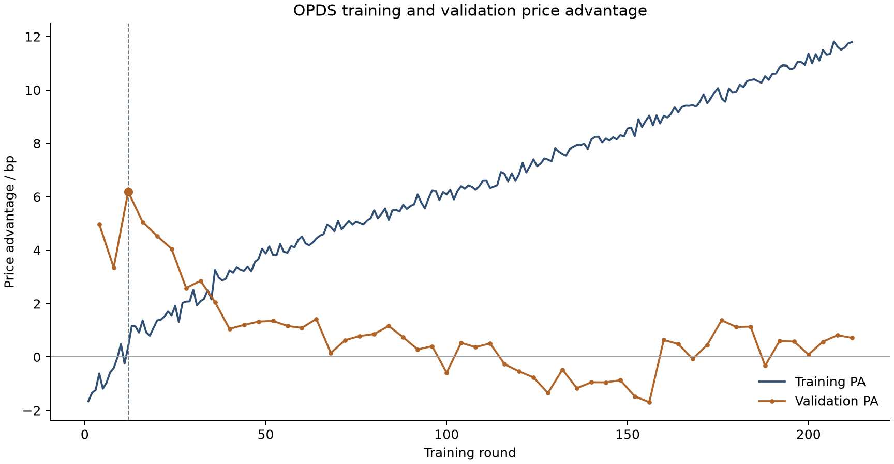

# OPDS 训练效果分析

本次训练在训练集的执行指标上改善，后期验证表现出现下降。第 12 轮在订单等权平均指标上更好，第 212 轮在成交金额加权指标上更好。选择模型时应先确定评价目标。以下数字来自同一批 9 只股票、540 笔测试订单，测试实际覆盖 2021-10-08 至 2021-12-30。数值单位为 bp，1 bp 等于 0.01%，价格优势越高越好。

| 模型 | 等权 PA | 等权扣费后 PA | 金额加权 PA | 金额加权扣费后 PA |
|---|---:|---:|---:|---:|
| 训练前初始化 | -3.1927 | -18.4848 | -4.3739 | -19.3970 |
| 第 12 轮验证最佳 | +0.7752 | -14.5216 | -1.8808 | -16.9071 |
| 第 212 轮最终模型 | -0.9776 | -16.0803 | -0.7342 | -15.7389 |
| TWAP | +0.0623 | -25.6150 | -0.1532 | -15.9635 |

训练 PA 从第 12 轮的 +0.3865 bp 上升到第 212 轮的 +11.7953 bp，验证 PA 同时从 +6.1887 bp 降到 +0.7154 bp。验证集排名前十的检查点中，九个位于前 36 轮。训练和验证曲线的分化与过拟合、时间分布变化相符。本次单随机种子实验无法把两者的影响单独识别。训练时采样动作、验证时确定性决策也会影响两条曲线的绝对差距。

官方早停的 patience 为 50，按验证次数计数，每 4 轮验证一次。因此第 12 轮刷新最佳后，又经过 200 轮才在第 212 轮停止。默认 restore_best_weights 为 False，原自动测试使用第 212 轮权重。第 12 轮根据验证集选出，随后单独在固定测试集上回测。[官方早停实现](https://github.com/microsoft/qlib/blob/v0.9.7/qlib/rl/trainer/callbacks.py)

第 12 轮比第 212 轮的订单等权 PA 高 1.7528 bp。SH600004 的股票内平均差为 +17.8678 bp，对整体均值贡献 +1.9853 bp，其余八只股票合计贡献约 −0.2325 bp。按 60 个交易日聚类重抽样的 95% 区间为 [-6.6771, 10.7219] bp，跨过零。样本对稳定优势的支持有限。该区间覆盖同日股票之间的共同变化，跨日序列相关性、模型选择及不同训练随机种子的变动仍需另外评估。

第 12 轮的扣费后结果为 +0.7752 − 15.2968 = -14.5216 bp。配置中的卖出费率为 0.15%，约贡献 15.0012 bp，最低费用额外贡献 0.2956 bp。价格改善的量级小于费用，扣费后均值因此仍为负。此处费用来自本次示例配置，实际账户费用需要按真实交易规则重新设置。

TWAP 的等权平均费用为 25.6773 bp，最低费用额外贡献 10.6772 bp。第 12 轮相对 TWAP 的等权扣费后改善为 11.0935 bp，其中约 10.3806 bp 来自费用差异。小订单拆分产生的最低费用对等权结果影响很大。金额加权扣费后 PA 则为第 12 轮 −16.9071 bp、第 212 轮 −15.7389 bp、TWAP −15.9635 bp，实际金额权重改变了模型排序。

OPDS 的 PAPenaltyReward 组合价格优势和成交量集中度惩罚，本次 scale 为 0.01、penalty 为 4。奖励中没有回测所用的最低费用及整手处理，训练还使用简化模拟器。官方文档说明训练和回测的执行约束存在差异。对每笔固定数量、最终全部成交的订单，单纯给所有策略减去相同固定费率，通常无法改变最优动作，成本优化应处理会随执行方式变化的费用及冲击。[官方奖励实现](https://github.com/microsoft/qlib/blob/v0.9.7/qlib/rl/order_execution/reward.py) [官方示例说明](https://github.com/microsoft/qlib/blob/v0.9.7/examples/rl_order_execution/README.md)

后期策略的验证平均步数由第 12 轮的 5.29 降为 3.67，最低费用影响的测试订单由 300 笔降为 20 笔，测试 PA 标准差从 42.15 增至 62.55 bp。这些现象显示执行行为和价格风险发生变化。确认具体交易时点、拆单次数及原因，需要在下一次运行保存逐步动作和成交日志。

接下来可以按以下顺序开展小规模实验。

1. 先明确按订单等权还是按成交金额加权优化，模型选择指标采用相应的同费用 TWAP 净节省。自动保存并加载该指标的验证最佳权重，尝试把早停 patience 调整为 5–10 次验证，并同步记录两种权重下的结果。
2. 用更接近回测的训练执行约束处理最低费用、100 股整手、未完成订单和流动性，评估会随执行路径改变的成本。增加逐步动作及成交日志，检查当前 0%、25%、50%、75%、100% 整笔订单比例的动作空间是否过粗。
3. 先对学习率 1e−4 与 3e−5、每轮更新重复次数 5 与 10 做 2×2 的短程筛选，再对候选设置使用 3–5 个随机种子和滚动时间验证。原训练每轮重复更新 25 次，可以检验减少重复拟合是否有利于样本外表现。
4. 扩大 9 只股票和单一时间切分的数据范围，纳入不同流动性及市场阶段。当前测试结果已经被查看，下一轮调参使用新的验证窗口，最终评价另留未来时间窗口。

本次扣除睡眠的训练及验证共约 27 小时 14 分，平均每轮约 7.71 分钟。按历史速度做保守预算，单个 24–32 轮试验约需 3.1–4.1 小时，2×2 筛选约需 12.3–16.4 小时。减少重复更新可能缩短耗时，环境模拟和机器状态也会影响速度，实际预算应由每项试验前几轮重新估计。多随机种子阶段再针对筛选出的少量设置运行。

本报告依据本次冻结数据和本地回测计算，初始模型由原环境及 seed 42 重建。540 笔测试订单均已匹配，成交比例均约 99.71%。费用节省、价格风险和泛化表现需要结合目标订单规模共同判断。

完成项目环境安装后，运行下面的命令可以重建 JSON 和本报告。环境已安装 matplotlib 时还会更新训练曲线图。

```powershell
.\run.ps1 -Stage verify
.\run.ps1 -Stage analyze
```

重建脚本为 [code/analyze_results.py](code/analyze_results.py)，计算结果为 [results/training_analysis.json](results/training_analysis.json)。在其他机器上可以使用本项目环境的 Python 执行同一脚本。



